<!-- AI-world profile README. Every image in /assets is a standalone SVG (text converted to outlines, animation built in). -->

 

<!-- training-run.svg: the runs are real projects and study topics; its loss curve is illustrative (the image says so) -->

 

 

 

 

<!-- ledger.svg is a snapshot of monthly contribution totals, Nov 2025 to Oct 2026; the hashes are computed from those figures -->

 

 

Plain-text version of this profile

**Vijit Agarwal** (vijitagarwal). Software engineer. I build full-stack products and wire AI into them.

BCA student at Chanakya University in Bengaluru (Software Engineering major, Cybersecurity minor). I build full-stack products and treat the AI part like any other dependency: it gets an interface, limits and a retry policy.

**Profile card:** role: software engineer · full-stack + AI; location: Bengaluru, India; studying: BCA, Chanakya University; major: Software Engineering; minor: Cybersecurity; principle: AI is a dependency. Give it an interface, limits and a retry policy; stack: Python, TypeScript, FastAPI, Next.js.

**Building:** DataDarshanam (Plain-English questions in, dashboards out); ExamHabitat (One engine, many exams); second-brain (Markdown notes to a Neo4j knowledge graph).
**In training:** ML from the math up; DSA and system design.

**Projects**

- [DataDarshanam](https://github.com/vijitagarwal/DataDarshanam) (Rebuilt): Ask in plain English, get an interactive dashboard and a short written takeaway. Built with Next.js 16, FastAPI, Groq, Pandas, Plotly, TypeScript.
- [FocusFriend](https://github.com/vijitagarwal/FocusFriend) (Deployed): Focus tracker with a custom Focus Score and a real-time leaderboard. Built with React, Node.js, Socket.io, Groq, Cloud Run, JavaScript.
- [HabitHabitat](https://github.com/vijitagarwal/habithabitat) (Live): Habit tracker and exam-prep cockpit on a custom useSyncExternalStore engine. Live on Vercel. Built with TanStack Start, Supabase, Recharts, Vercel, TypeScript.
- [ExamHabitat](https://github.com/vijitagarwal/examhabitat) (In Progress): The multi-exam rebuild: the dashboard adapts to the exam you pick. In progress. Built with TanStack Start, React 19, Supabase, Framer Motion, TypeScript.

**How DataDarshanam answers a question:** the browser (Next.js) sends the question to FastAPI as `POST /query`; FastAPI hands the work to Groq (reasoning), Pandas (analysis) and Plotly (charts) and returns a chart plus a short insight with a 200 OK.

**Tools**

- Languages: Python, TypeScript, JavaScript, Java, C++
- Front end: React, Next.js, Tailwind CSS, TanStack, Framer Motion
- Back end: FastAPI, Node.js, Express, Socket.io
- AI / ML: Groq, scikit-learn, Pandas, Plotly
- Data: PostgreSQL, Supabase, BigQuery, Neo4j
- Cloud + DevOps: Docker, Google Cloud, Vercel, GitHub Actions, Git

**Contributions, last 12 months:** 263 in total (Nov 1, Dec 4, Jan 25, Feb 3, Mar 17, Apr 1, May 30, Jun 8, Jul 136, Aug 34, Sep 4, Oct 0). Peak day: 26 contributions on Jul 20, 2026.

**Git log**

- JUL 2026: ML Engineering Intern, FlyRank. Six weeks in the company's inaugural global AI internship cohort.
- 2026: Event Coordinator, OJAS 2026. Web/App Dev Sprint at the OJAS 2026 student fest.
- 2024–2028: BCA, Chanakya University. Bengaluru. Software Engineering major, Cybersecurity minor.

**Contact:** [vijitagarwal123@gmail.com](mailto:vijitagarwal123@gmail.com) · [LinkedIn](https://linkedin.com/in/agarwalvijit) · [X (@VijitCodes)](https://x.com/VijitCodes)

