<!-- Military-theme profile README, folder version. The images (all the elements and icons) are in the military-profile folder at the top of the repo; each is a standalone SVG (text converted to outlines, animation built in). To show this theme on the profile, this text has to be the repo's README.md: copy alt-readme-military-profile.md over README.md. -->


 
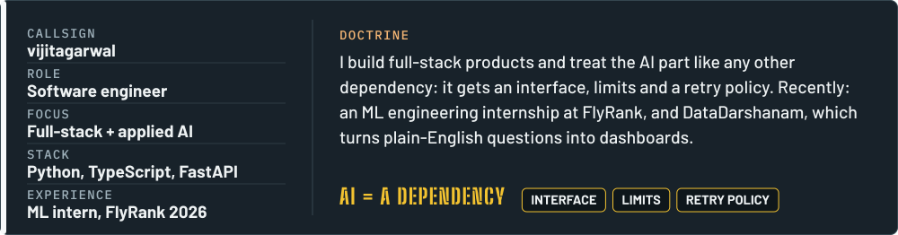

 

 
<a href="https://github.com/vijitagarwal/DataDarshanam"></a>

<a href="https://github.com/vijitagarwal/FocusFriend"></a>
<a href="https://github.com/vijitagarwal/habithabitat"></a>
<a href="https://github.com/vijitagarwal/examhabitat"></a>

 

 
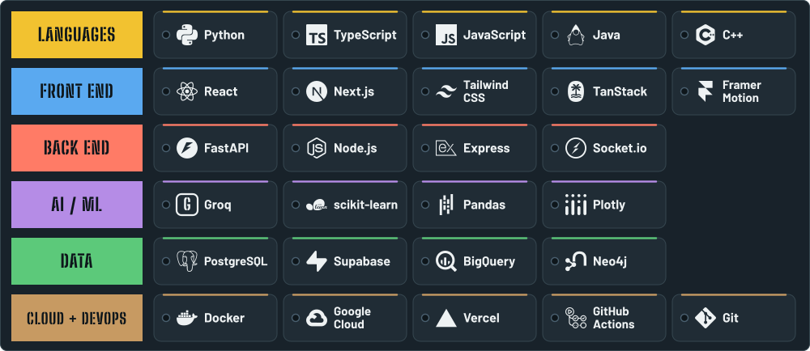

<!-- radar.svg (in military-profile) is redrawn every day by .github/workflows/refresh-military-profile.yml from the public contribution calendar; do not edit it by hand -->

 
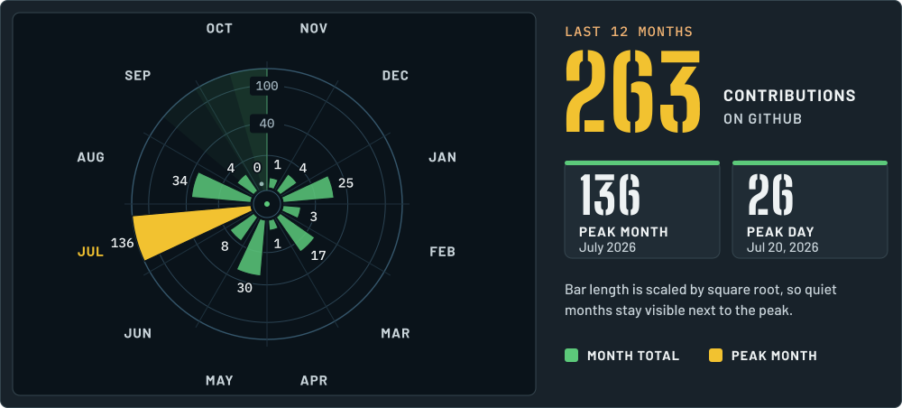

 
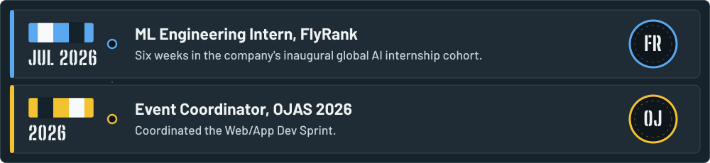


Plain-text version of this profile

**Vijit Agarwal** (vijitagarwal). Software engineer. I build full-stack products and wire AI into them.

I build full-stack products and treat the AI part like any other dependency: it gets an interface, limits and a retry policy. Recently: an ML engineering internship at FlyRank, and DataDarshanam, which turns plain-English questions into dashboards.

**Building:** DataDarshanam (Plain-English questions in, dashboards out); ExamHabitat (One engine, many exams); second-brain (Markdown notes to a Neo4j knowledge graph).

**In training:** ML from the math up; DSA and system design.

**Projects**

- [DataDarshanam](https://github.com/vijitagarwal/DataDarshanam) (Rebuilt): Ask in plain English, get an interactive dashboard and a short written takeaway. Built with Next.js 16, FastAPI, Groq, Pandas, Plotly, TypeScript.
- [Focus Friend](https://github.com/vijitagarwal/FocusFriend) (Deployed): Focus tracker with a custom Focus Score and a real-time leaderboard. Built with React, Node.js, Socket.io, Groq, Cloud Run, JavaScript.
- [HabitHabitat](https://github.com/vijitagarwal/habithabitat) (Live): Habit tracker and exam-prep cockpit on a custom useSyncExternalStore engine. Live on Vercel. Built with TanStack Start, Supabase, Recharts, Vercel, TypeScript.
- [ExamHabitat](https://github.com/vijitagarwal/examhabitat) (In Progress): The multi-exam rebuild: the dashboard adapts to the exam you pick. In progress. Built with TanStack Start, React 19, Supabase, Framer Motion, TypeScript.

**Tools**

- Languages: Python, TypeScript, JavaScript, Java, C++
- Front end: React, Next.js, Tailwind CSS, TanStack, Framer Motion
- Back end: FastAPI, Node.js, Express, Socket.io
- AI / ML: Groq, scikit-learn, Pandas, Plotly
- Data: PostgreSQL, Supabase, BigQuery, Neo4j
- Cloud + DevOps: Docker, Google Cloud, Vercel, GitHub Actions, Git

**Contributions, last 12 months:** shown on the radar above, one bar per month. It is redrawn every day from the public GitHub contribution calendar, so it is always current.

**Service record**

- JUL 2026: ML Engineering Intern, FlyRank. Six weeks in the company's inaugural global AI internship cohort.
- 2026: Event Coordinator, OJAS 2026. Coordinated the Web/App Dev Sprint.

**Contact:** [vijitagarwal123@gmail.com](mailto:vijitagarwal123@gmail.com) · [LinkedIn](https://linkedin.com/in/agarwalvijit) · [X (@VijitCodes)](https://x.com/VijitCodes)

