<!-- Medieval profile README, folder version. The images (all the elements and icons) are in the medieval-profile folder at the top of the repo; each is a standalone SVG (text converted to outlines, animation built in). To show this theme on the profile, this text has to be the repo's README.md: copy alt-readme-medieval-profile.md over README.md. -->



 

 
<a href="https://github.com/vijitagarwal/DataDarshanam"></a>
<a href="https://github.com/vijitagarwal/FocusFriend"></a>
<a href="https://github.com/vijitagarwal/habithabitat"></a>
<a href="https://github.com/vijitagarwal/examhabitat"></a>

 

 

<!-- castle-wall.svg (in medieval-profile) is redrawn every day by .github/workflows/refresh-medieval-profile.yml from the public contribution calendar; do not edit it by hand -->

 

 

Plain-text version of this profile

**Vijit Agarwal** (vijitagarwal). Software engineer. I build full-stack products and wire AI into them.

I build full-stack products and treat the AI part like any other dependency: it gets an interface, limits and a retry policy. Recently: an ML engineering internship at FlyRank, and DataDarshanam, which turns plain-English questions into dashboards.

**Building:** DataDarshanam (plain-English questions in, dashboards out); ExamHabitat (one engine, many exams); second-brain (Markdown notes to a Neo4j knowledge graph).

**In training:** ML from the math up; DSA and system design.

**Quests completed**

- [DataDarshanam](https://github.com/vijitagarwal/DataDarshanam) (Rebuilt): Ask in plain English, get an interactive dashboard and a short written takeaway. Built with Next.js 16, FastAPI, Groq, Pandas, Plotly, TypeScript.
- [FocusFriend](https://github.com/vijitagarwal/FocusFriend) (Deployed): Focus tracker with a custom Focus Score and a real-time leaderboard. Built with React, Node.js, Socket.io, Groq, Cloud Run, JavaScript.
- [HabitHabitat](https://github.com/vijitagarwal/habithabitat) (Live): Habit tracker and exam-prep cockpit on a custom useSyncExternalStore engine. Live on Vercel. Built with TanStack Start, Supabase, Recharts, Vercel, TypeScript.
- [ExamHabitat](https://github.com/vijitagarwal/examhabitat) (In progress): The multi-exam rebuild: the dashboard adapts to the exam you pick. In progress. Built with TanStack Start, React 19, Supabase, Framer Motion, TypeScript.

**The royal road, how DataDarshanam answers a question:** the question leaves the browser (Next.js, the gatehouse) as `POST /query` and reaches FastAPI (the keep), which sends riders to Groq (the oracle) for the reasoning, Pandas (the ledger) for the analysis and Plotly (the mapmaker) for the charts, and sends back a chart plus a short insight.

**The armory, tools I carry**

- Languages: Python, TypeScript, JavaScript, Java, C++
- Front end: React, Next.js, Tailwind CSS, TanStack, Framer Motion
- Back end: FastAPI, Node.js, Express, Socket.io
- AI / ML: Groq, scikit-learn, Pandas, Plotly
- Data: PostgreSQL, Supabase, BigQuery, Neo4j
- Cloud + DevOps: Docker, Google Cloud, Vercel, GitHub Actions, Git

**The castle wall, contributions in the last twelve months:** one stone tower per month, the busiest month flying a banner. It is redrawn every day from the public GitHub contribution calendar, so it is always current.

**The chronicle**

- Jul 2026: ML engineering intern at FlyRank. Six weeks in the company's inaugural global AI internship cohort.
- 2026: Event coordinator for the Web/App Dev Sprint at OJAS 2026.

**Contact:** [vijitagarwal123@gmail.com](mailto:vijitagarwal123@gmail.com) · [LinkedIn](https://linkedin.com/in/agarwalvijit) · [X (@VijitCodes)](https://x.com/VijitCodes)

